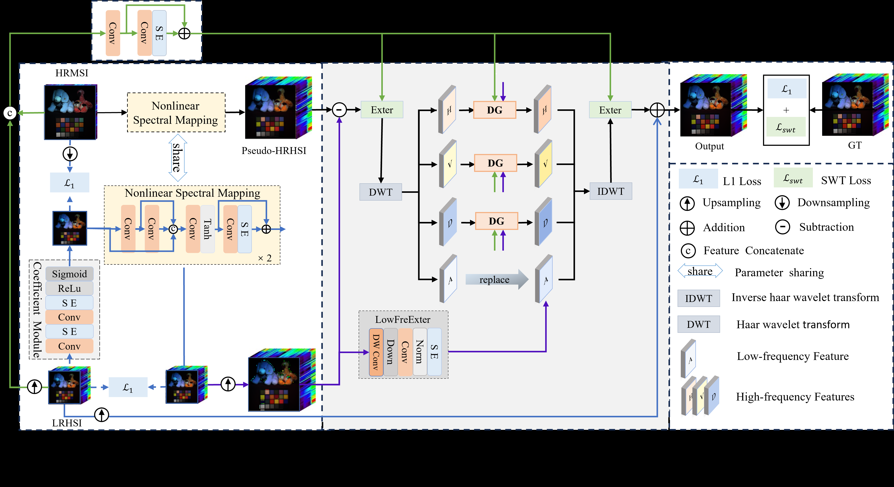

# Learning Spectral Consistency and Detail Refinement for Hyperspectral Image Fusion

The code for 《 Learning Spectral Consistency and Detail Refinement for Hyperspectral Image Fusion 》


Our model (SCDRNet) was trained on an NVIDIA A800-SXM4-80GB GPU.

<div align="center">
    
</div>

## 👉 Data

NOTE: the training/testing scripts expect the following directory layout:

```
Data/
├── CAVE/
│   ├── Train/HSI/
│   └── Test/HSI/
└── Harvard/
    ├── Train/HSI/
    └── Test/HSI/
```

Datasets:

* [CAVE](https://www.cs.columbia.edu/CAVE/databases/multispectral/)
* [Harvard](http://vision.seas.harvard.edu/hyperspec/)
* [Pavia](https://github.com/liangjiandeng/HyperPanCollection)

## 🌿 Getting Started

### Environment Setup

    conda create -n scdrnet_env python==3.11

    conda activate scdrnet_env

    pip install -r requirements.txt

### Train

    python train_cave.py

Checkpoints and logs are written to `./checkpoint_cave/model/`.

### Test

    python Test.py

The test script loads `./checkpoint_cave/model/model_%04d.pth` (edit `test_epoch` to match your checkpoint),
saves fused results to `./test_save/model/<dataset>/`, and reports PSNR / RMSE / SAM / ERGAS / UIQI.

## 📁 Code Structure

```
SCDRNet/
├── Model/
│   └── model.py            # SCDRNet: coefficient estimation + spectral reconstruction + DWT/DGHA refinement
├── train_cave.py           # training script (CAVE / KAIST switchable)
├── Test.py                 # testing / evaluation script
├── data_load.py            # dataset classes (CAVE / Harvard / KAIST / ICVL ...)
├── Utils.py                # data preparation, Gaussian downsample, SSIM, etc.
├── calculate_metrics.py    # PSNR / RMSE / SAM / ERGAS / UIQI and AverageMeter
├── requirements.txt
├── SCDRNet.pdf             # paper
└── SCDRNet.png             # framework figure
```


## Citation

If this code is useful for your research, please cite this paper.

## 🌸 Acknowledgment

The repository layout, training/testing pipeline and evaluation code follow our previous work
[SINet](https://github.com/1469102331/SINet), which in turn refers to
[DSPNet](https://github.com/syc11-25/DSPNet/tree/main),
[LRTN](https://github.com/YuanyeLiu/Low-Rank-Transformer-For-High-Resolution-Hyperspectral-Computational-Imaging),
[Hyper-DSNet](https://github.com/liangjiandeng/Hyper-DSNet) and
[HyperPanCollection](https://github.com/liangjiandeng/HyperPanCollection).
We thank all the contributors for open-sourcing.
